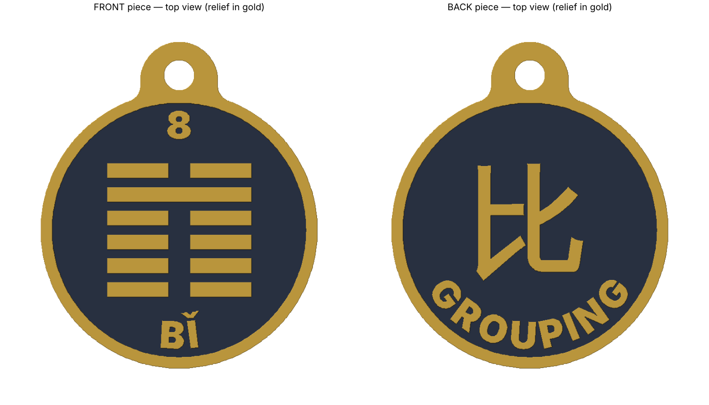

# I Ching #8 Bǐ (比, Grouping) keychain: two-piece version



## What changed from v1

| | v1 (old G-code) | v2 (this) |
|---|---|---|
| Size | Ø 34.5 mm | Ø 50 mm + keyring lug (50 × 59 mm) |
| Thickness | 4 mm body + 1 mm detail | 2 × 2.4 mm body + 1.2 mm relief on each face = **7.2 mm** assembled |
| Hexagram bars | 0.65 mm wide (one nozzle line, unreadable) | **2.6 mm** wide, 1.7 mm gaps, 4 mm break |
| Text | none | Inter Black, 5 mm cap height, ~1.3 mm strokes (3+ nozzle lines) |
| Sides | 1 face | 2 pieces: **front** (hexagram, 8, BǏ) + **back** (比, GROUPING) |
| Keyring hole | Ø 5.85 mm, 0.6 mm wall to edge | Ø 5.5 mm in a separate lug, ≥ 2.25 mm walls, full 7.2 mm thick |

## Files

| File | Use |
|---|---|
| `keychain_iching08_bi_kobra2pro.gcode` | Ready to print on Anycubic Kobra 2 Pro (PLA, 0.4 nozzle, 0.2 mm). Both pieces on one plate. ~47 min, ~13 g. |
| `keychain_plate_kobra2pro.3mf` | Both pieces placed on the bed, for your own slicer. |
| `keychain_front.stl`, `keychain_back.stl` | Single pieces. |
| `kobra2pro_pla.ini` | PrusaSlicer settings used for the G-code. |
| `generate_keychain.py` | Parametric source (size, thickness, text, fonts). |

## Print

- Print both pieces **face up**, no supports, no brim.
- Key settings: 3 walls, 5 top / 4 bottom layers, 25 % gyroid, Arachne walls, 40 mm/s outer wall.
- The start G-code is the same sequence as the old file (G28 + `M420 S1` saved mesh + purge line).

### Two colours (best readability)

Pause and swap filament at **Z = 2.4 mm** (start of layer 13). The base stays one colour; the rim, hexagram and text print in the second colour. In your slicer: layer preview → right-click the layer at 2.6 mm → *Add pause / colour change*.

## Assembly

1. Remove any first-layer lip with a deburring tool or fine sandpaper (a 0.4 mm chamfer is already on the bottom edge).
2. Optional alignment: cut two 2.4 mm pieces of 1.75 mm filament and push them into the Ø 2.1 mm holes on one piece.
3. Glue the flat backs together with CA glue (superglue) or 2-part epoxy. Line up the keyring holes and edges, and clamp for 5 min.
4. Fit a split ring or jump ring through the Ø 5.5 mm hole.

## Regenerate / customise

```bash
pip install shapely manifold3d trimesh fonttools numpy
python generate_keychain.py .
```

Change the parameters at the top of the script (`COIN_R`, `BASE_H`, `RELIEF_H`, `TEXT_CAP`, the text strings in `main()`), then re-slice.
